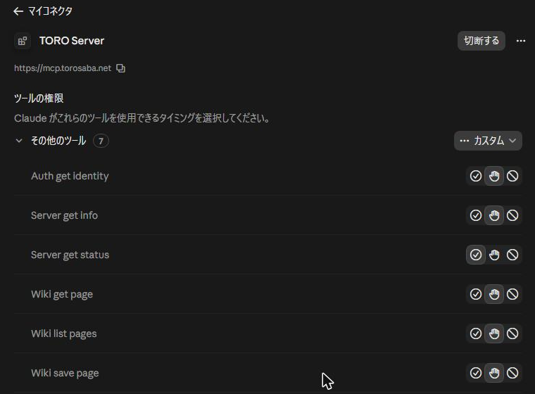
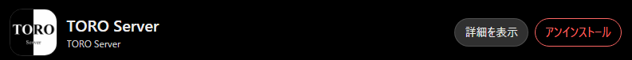
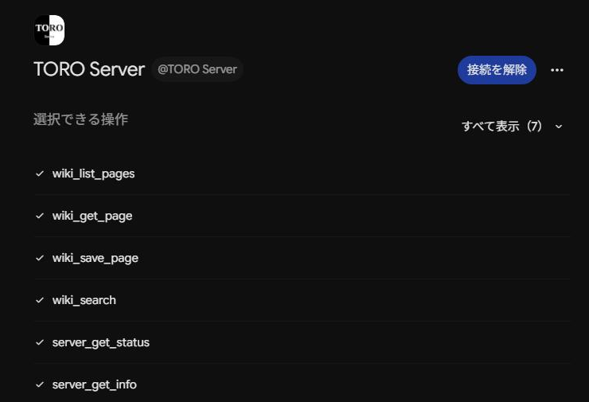

# AIクライアントの接続方法

Claude、ChatGPT、Gemini などの AI クライアントを TORO Server につなぐ手順です。つなぐと、AI が Wiki を読んだり検索したり、サーバーの状態を調べたりできます。TORO Server の Discord メンバーは、Wiki の編集もできます。

## 接続先

```text
https://mcp.torosaba.net/
```

名前は `TORO Server` にしてください。認証の設定は自動で見つかるので、入力するのは名前とこの URL だけです。

## Claude

1. [カスタマイズ] → [コネクタ] → [追加] → [カスタムコネクタを追加] を開きます。
2. 名前に `TORO Server`、MCP サーバー URL に接続先を入力し、[続ける] を押します。
3. 認証は [今すぐサインイン] を選びます。自動では [サインインなし] が選ばれるので、変更が必要です。
4. OAuth のクライアントは [自動的に登録] を選び、[追加] を押します。
5. 開いた「連携の許可」の画面で承認すると、7 種類のツールが使えるようになります。未ログインなら、先に Discord でログインします。



## ChatGPT

1. [プラグイン] → [追加] → [カスタム MCP サーバーを追加] を開きます。
2. アイコンの [+] を押し、保存しておいた [TORO Server のアイコン](../attachments/toro-server-icon.png) を選びます。
3. 名前に `TORO Server`、接続タイプの [サーバー URL] に接続先を入力します。OAuth は自動で判別されます。
4. 確認のチェックを入れて [プラグインとして作成] を押します。
5. [TORO Server に接続] を押し、開いた「連携の許可」の画面で承認します。

アイコンを選ばないと、ChatGPT が自動で選んだ画像になります。登録のあとで変えるには、削除して登録し直します。



## Gemini

1. [連携サービス] → [カスタム] を開きます。
2. MCP サーバーの URL に接続先を入力し、[次へ] を押します。名前は自動で `TORO Server` になります。
3. 確認のチェックを入れて [接続] を押し、Google の画面で [同意して続行] を押します。
4. 開いた「連携の許可」の画面で承認し、保存の画面で [接続] を押します。
5. チャットの中で `@TORO Server` を呼び出して使います。

「アカウントのリンクが必要です」と出たときは、もう一度 [次へ] から進めてください。



## 手元のアプリ (Claude Desktop、Cursor など)

設定ファイル (`claude_desktop_config.json` など) に次の定義を足します。アプリによっては名前に空白を使えないので、ここだけ `toro-server` と書きます。

```json
{
  "mcpServers": {
    "toro-server": {
      "url": "https://mcp.torosaba.net/"
    }
  }
}
```

## トークンでつなぐとき

OAuth を使えないクライアントでは、トークンを使います。

1. [認証のページ](https://auth.torosaba.net/) に Discord でログインし、[トークンを発行する] を押します。
2. 表示されたトークンをコピーし、クライアントの設定で `Authorization: Bearer <トークン>` として送るようにします。

トークンについて、次のことに注意してください。

- 表示されるのは発行したときの一度だけです。あとから見ることはできません。
- 有効期限は 90 日です。
- なくしたときや期限が近いときは [トークンを再作成する] を押します。再作成すると、それまでのトークンは使えなくなります。
- 人に見せないでください。

## 使えるツール

| ツール | できること | 使える人 |
| :--- | :--- | :--- |
| `wiki_list_pages` | Wiki の原稿の一覧を見る | だれでも |
| `wiki_get_page` | Wiki の原稿と Git SHA を読む | だれでも |
| `wiki_search` | Wiki の全文を語句で探す | だれでも |
| `wiki_save_page` | Wiki の原稿を保存し、GitHub にコミットする | メンバー |
| `server_get_status` | Minecraft サーバーの接続人数や状態を見る | だれでも |
| `server_get_info` | TORO Server の各サービスの案内を見る | だれでも |
| `auth_get_identity` | 呼び出し元の身元と編集の権限を確かめる | ログイン時 |

各サービスの URL と役割は [サービスのURLと役割](./サービスのURLと役割.md) を見てください。
